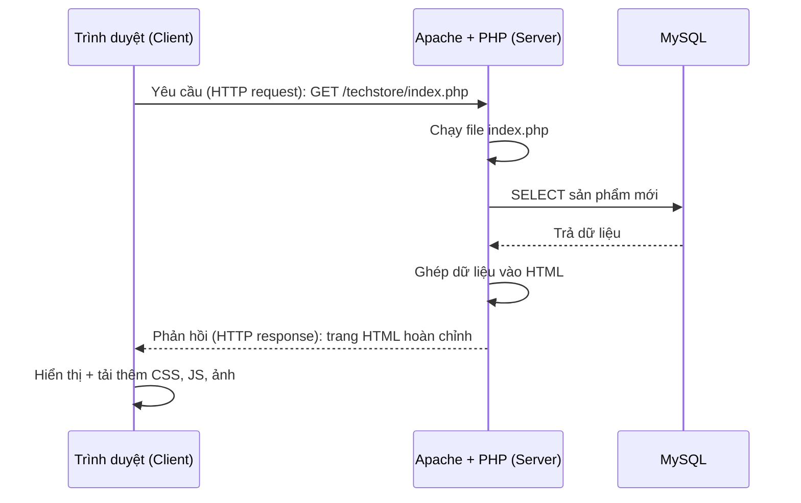
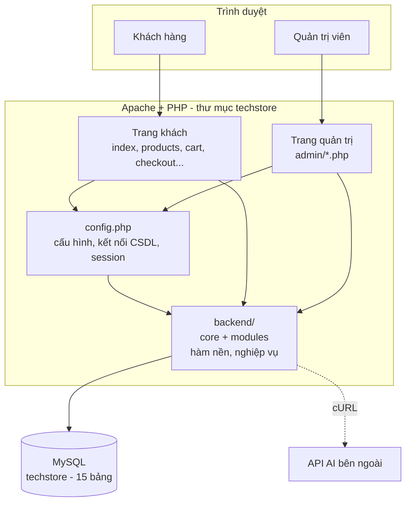
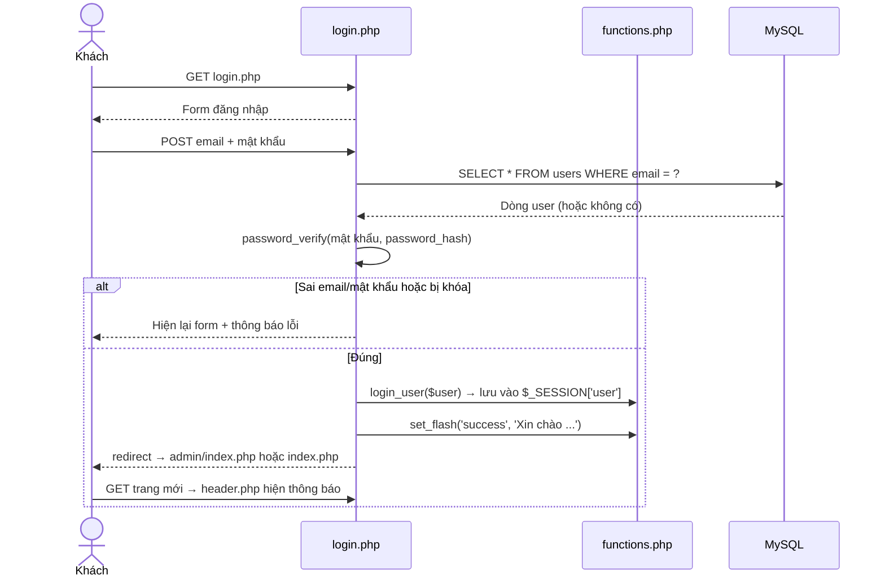
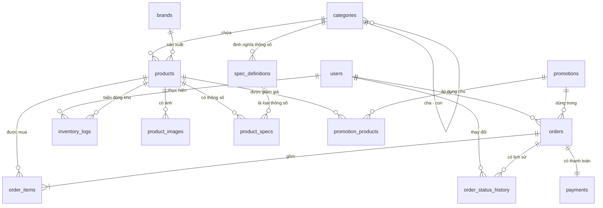
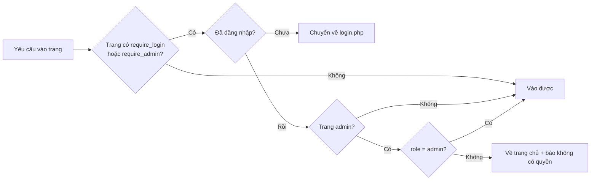
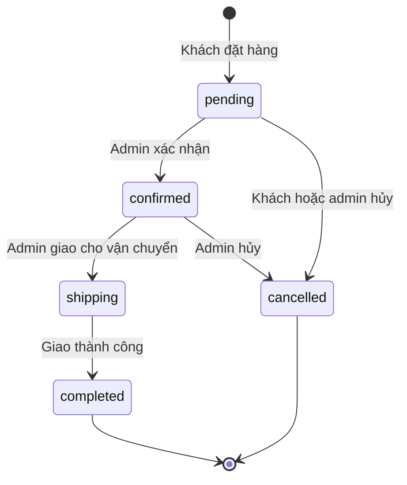
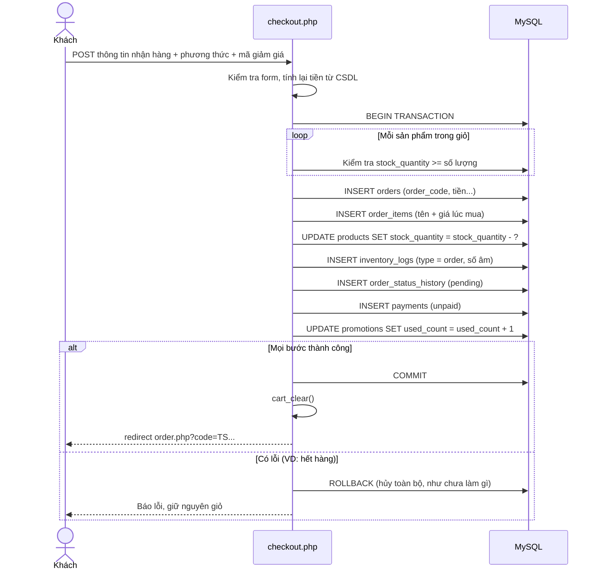
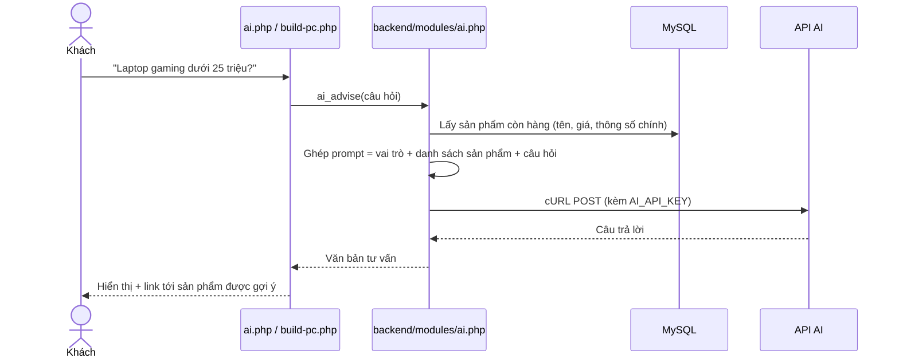

# TÀI LIỆU HỆ THỐNG ATS E-STORE
### Website cửa hàng Linh kiện, Máy tính, Laptop trực tuyến

> Tài liệu này giải thích toàn bộ hệ thống, từ khái niệm cơ bản đến chi tiết từng file, từng bảng, từng luồng xử lý.
> Đọc theo thứ tự từ trên xuống. Phần 1–3 dành cho người mới, phần 4 trở đi đi sâu vào code.
> Các sơ đồ viết bằng **Mermaid**: xem đẹp trên GitHub, hoặc VS Code có cài extension "Markdown Preview Mermaid Support".

---

## MỤC LỤC

1. [Tổng quan đề tài](#1-tổng-quan-đề-tài)
2. [Kiến thức nền cần nắm](#2-kiến-thức-nền-cần-nắm)
3. [Kiến trúc hệ thống và cách một trang chạy](#3-kiến-trúc-hệ-thống-và-cách-một-trang-chạy)
4. [Cấu trúc thư mục và vai trò từng file](#4-cấu-trúc-thư-mục-và-vai-trò-từng-file)
5. [Phần nền chi tiết](#5-phần-nền-chi-tiết)
6. [Cơ sở dữ liệu](#6-cơ-sở-dữ-liệu)
7. [Session: hệ thống nhớ người dùng thế nào](#7-session-hệ-thống-nhớ-người-dùng-thế-nào)
8. [Đăng nhập và phân quyền](#8-đăng-nhập-và-phân-quyền)
9. [Bảo mật](#9-bảo-mật)
10. [Luồng xử lý từng chức năng](#10-luồng-xử-lý-từng-chức-năng)
11. [Nghiệp vụ quan trọng: đơn hàng, kho, khuyến mãi, tương thích, AI](#11-nghiệp-vụ-quan-trọng)
12. [Giao diện](#12-giao-diện)
13. [Cách viết thêm một chức năng](#13-cách-viết-thêm-một-chức-năng)
14. [Lỗi thường gặp và cách xử lý](#14-lỗi-thường-gặp-và-cách-xử-lý)
15. [Câu hỏi thường gặp khi bảo vệ đồ án](#15-câu-hỏi-thường-gặp-khi-bảo-vệ-đồ-án)
16. [Bảng thuật ngữ](#16-bảng-thuật-ngữ)

---

## 1. TỔNG QUAN ĐỀ TÀI

### 1.1. Mục tiêu
Xây dựng website bán linh kiện máy tính, PC và laptop, cho phép:
- **Khách hàng** xem, tìm kiếm, lọc, so sánh sản phẩm; tự build PC có kiểm tra tương thích; đặt hàng và theo dõi đơn.
- **Quản trị viên** quản lý sản phẩm, kho, khuyến mãi, đơn hàng, khách hàng và xem thống kê.
- **AI** tư vấn sản phẩm và tối ưu cấu hình PC.

### 1.2. Ba nhóm người dùng

| Nhóm | Là ai | Được làm gì |
|---|---|---|
| Khách vãng lai | Chưa đăng nhập | Xem sản phẩm, tìm kiếm, lọc, so sánh, thêm giỏ hàng, build PC, hỏi AI |
| Khách hàng | Đã đăng nhập, `role = 'customer'` | Thêm vào đó: đặt hàng, xem đơn, quản lý tài khoản |
| Quản trị viên | `role = 'admin'` | Vào thư mục `admin/` để quản lý toàn bộ cửa hàng |

> Khách vãng lai vẫn bỏ được hàng vào giỏ (giỏ lưu trong session). Chỉ khi **thanh toán** mới bắt buộc đăng nhập. Các trang bán hàng thật cũng làm như vậy để khách không bị làm phiền.

### 1.3. Công nghệ

| Thành phần | Công nghệ | Vai trò |
|---|---|---|
| Giao diện | HTML, CSS | Hiển thị. CSS viết tay theo thiết kế Figma |
| Tương tác | JavaScript thuần | Menu thả xuống, đóng thông báo, hỏi xác nhận khi xóa |
| Xử lý | PHP thuần (không framework) | Nhận yêu cầu, xử lý, truy vấn CSDL, sinh HTML |
| CSDL | MySQL (qua PDO) | Lưu dữ liệu |
| Môi trường | XAMPP (Apache + MySQL + PHP) | Chạy web trên máy cá nhân |
| Icon | Bootstrap Icons (CDN) | Biểu tượng |
| Font | Inter (Google Fonts) | Font chữ theo Figma |
| AI | API Gemini / OpenAI / Claude (qua cURL) | Tư vấn và tối ưu cấu hình |

### 1.4. Vì sao chọn kiểu "PHP thuần, mỗi trang một file"?
- **Dễ hiểu:** mở một file là thấy toàn bộ chức năng, từ xử lý dữ liệu đến giao diện.
- **Dễ giải thích khi bảo vệ:** không phải giải thích router, class, kế thừa hay namespace.
- **Vẫn gọn:** phần dùng chung (kết nối CSDL, header/footer, các hàm) được tách riêng vào `config.php` và các thư mục `backend/`, `frontend/layout/`, `admin/layout/`, nên không lặp code.

Đánh đổi: đây không phải mô hình MVC. Logic và giao diện nằm chung một file, nhưng luôn tách rõ: **phần xử lý ở trên, phần HTML ở dưới**.

---

## 2. KIẾN THỨC NỀN CẦN NẮM

### 2.1. Mô hình Client – Server



Điểm quan trọng: **PHP chạy trên server, không chạy trên trình duyệt.** Trình duyệt chỉ nhận về HTML. Bấm "Xem nguồn trang" (Ctrl+U) sẽ không thấy dòng PHP nào.

### 2.2. GET và POST

| | GET | POST |
|---|---|---|
| Dữ liệu nằm ở | Trên URL: `products.php?q=laptop&page=2` | Ẩn trong thân yêu cầu |
| PHP đọc bằng | `$_GET['q']` | `$_POST['email']` |
| Dùng khi | **Xem / lọc / tìm** (không thay đổi dữ liệu) | **Thay đổi dữ liệu**: đăng ký, đăng nhập, thêm giỏ hàng, đặt hàng, sửa, xóa |
| Bấm F5 | An toàn | Trình duyệt hỏi "gửi lại form?" |

Trong code: `if ($_SERVER['REQUEST_METHOD'] === 'POST') { ... }` nghĩa là "nếu người dùng vừa bấm gửi form".

### 2.3. Mẫu PRG (Post – Redirect – Get)
Sau khi xử lý POST **thành công**, hệ thống luôn **chuyển hướng** (redirect) sang một trang GET. Nhờ vậy, bấm F5 sẽ không gửi lại form và không tạo trùng đơn hàng.

```
Người dùng bấm "Lưu"  →  POST account.php  →  cập nhật CSDL  →  redirect('account.php')
                                                                     ↓
                                              GET account.php  →  hiện thông báo "Đã cập nhật"
```

Nếu **có lỗi**, hệ thống **không redirect** mà hiển thị lại form ngay, kèm thông báo lỗi và giữ nguyên dữ liệu đã nhập.

### 2.4. Session và Cookie
HTTP "không có trí nhớ": mỗi yêu cầu là độc lập. Để biết người dùng đã đăng nhập hay chưa, PHP dùng **session**:
1. `session_start()` tạo một mã phiên ngẫu nhiên, gửi về trình duyệt dưới dạng cookie `PHPSESSID`.
2. Dữ liệu (ai đang đăng nhập, giỏ hàng...) được lưu **trên server**, gắn với mã đó.
3. Ở các lần sau, trình duyệt gửi kèm cookie, PHP tìm đúng dữ liệu cho người đó qua biến `$_SESSION`.

### 2.5. PDO và Prepared Statement
PDO là thư viện kết nối CSDL của PHP. **Prepared statement** tách câu SQL và dữ liệu:
```php
// SAI – nối chuỗi trực tiếp, bị SQL injection
$pdo->query("SELECT * FROM users WHERE email = '$email'");

// ĐÚNG – dùng dấu ?, PDO tự xử lý dữ liệu an toàn
$stmt = $pdo->prepare("SELECT * FROM users WHERE email = ?");
$stmt->execute([$email]);
```
Hệ thống gói gọn việc này trong các hàm `db_all`, `db_one`, `db_value`, `db_run`.

---

## 3. KIẾN TRÚC HỆ THỐNG VÀ CÁCH MỘT TRANG CHẠY

### 3.1. Sơ đồ tổng thể



### 3.2. Giải phẫu một trang PHP
Mọi trang đều có cùng một khuôn 4 phần:

```php
<?php
// ① NẠP NỀN: cấu hình, kết nối CSDL, session, các hàm
require 'config.php';
require_login();                       // (nếu trang cần đăng nhập)

// ② XỬ LÝ: chỉ chạy khi người dùng gửi form
$errors = [];
if ($_SERVER['REQUEST_METHOD'] === 'POST') {
    // lấy dữ liệu → kiểm tra → nếu hợp lệ: ghi CSDL, set_flash, redirect
}

// ③ LẤY DỮ LIỆU để hiển thị
$user = db_one("SELECT * FROM users WHERE id = ?", [current_user()['id']]);

// ④ HIỂN THỊ: header → HTML của trang → footer
$title = 'Tài khoản của tôi';
require 'frontend/layout/header.php';
?>
<h1>Xin chào <?= e($user['full_name']) ?></h1>
<?php require 'frontend/layout/footer.php'; ?>
```

> `<?= ... ?>` là cách viết tắt của `<?php echo ...; ?>`.

### 3.3. Ví dụ đầy đủ: điều gì xảy ra khi bấm "Đăng nhập"



---

## 4. CẤU TRÚC THƯ MỤC VÀ VAI TRÒ TỪNG FILE

```
techstore/
├── index.php                Trang chủ
├── config.php               Cấu hình, kết nối CSDL, tự nạp backend/ (mọi trang require đầu tiên)
├── .htaccess                Giữ địa chỉ ngắn: /cart.php -> frontend/pages/cart.php
│
├── frontend/                ══ GIAO DIỆN KHÁCH HÀNG ══
│   ├── pages/               register, login, logout, account, change_password,
│   │                        products, product, compare, cart, build-pc, checkout,
│   │                        orders, order, ai
│   ├── layout/              header, footer, product_card, account_sidebar
│   └── assets/              css/ (style.css, admin.css) · js/main.js · img/
│
├── admin/                   ══ GIAO DIỆN QUẢN TRỊ ══
│   ├── index.php  products.php  product_form.php  categories.php  specs.php  inventory.php
│   ├── promotions.php  orders.php  order_detail.php  customers.php  customer_detail.php
│   └── layout/              admin_header, admin_footer
│
├── backend/                 ══ XỬ LÝ (trình duyệt không mở trực tiếp được) ══
│   ├── core/                db.php · helpers.php · auth.php · security.php
│   └── modules/             product · cart · promotion · compare · order ·
│                            payment · payos · compatibility · ai
│
├── uploads/products/        Ảnh sản phẩm tải lên
└── database/techstore.sql
```

**Nguyên tắc:** `frontend/` là giao diện khách, `admin/` là giao diện quản trị, `backend/` là phần xử lý dùng chung cho cả hai. Địa chỉ trang vẫn ngắn gọn (`/cart.php`) nhờ quy tắc trong `.htaccess` ở thư mục gốc (cần `mod_rewrite`, XAMPP bật sẵn).

### 4.1. File nền

| File | Vai trò |
|---|---|
| `config.php` | Khai báo hằng số (tên web, đường dẫn gốc, thông tin MySQL, khóa API), bật session, kết nối PDO, **tự nạp mọi file trong `backend/core/` rồi `backend/modules/`** |
| `backend/core/db.php` | Hàm truy vấn CSDL: `db_all`, `db_one`, `db_value`, `db_run`, `db_last_id`, `placeholders`, `db_now` |
| `backend/core/helpers.php` | Hàm hiển thị/định dạng (`e`, `url`, `money`...), form, chuyển trang, thông báo flash, phân trang, upload ảnh |
| `backend/core/auth.php` | Đăng nhập, lấy người dùng hiện tại, phân quyền (`require_login`, `require_admin`) |
| `backend/modules/product.php` | `product_sql()` (câu SELECT sản phẩm kèm ảnh, thương hiệu), `stock_badge()` |
| `backend/modules/cart.php` | Giỏ hàng (session), phí giao hàng, tổng tiền |
| `backend/modules/promotion.php` | Khuyến mãi tự động, mã giảm giá, giá sau khuyến mãi |
| `backend/modules/compare.php` | So sánh sản phẩm (session, tối đa 4) |
| `backend/modules/order.php` | Trạng thái đơn, luồng trạng thái, đổi trạng thái (hủy → hoàn kho/hoàn tiền), lịch sử, sinh mã đơn |
| `backend/modules/payment.php` | Danh sách phương thức thanh toán, nhãn trạng thái thanh toán |
| `backend/modules/payos.php` | Tích hợp thanh toán QR payOS |
| `backend/modules/compatibility.php` | Kiểm tra tương thích linh kiện |
| `backend/modules/ai.php` | Gọi API AI |
| `frontend/layout/product_card.php` | Thẻ sản phẩm dùng chung (trang chủ, danh sách, sản phẩm liên quan) |
| `frontend/layout/header.php` | Phần đầu trang khách: `<head>`, logo, ô tìm kiếm, giỏ hàng, menu tài khoản, menu danh mục, thông báo flash |
| `frontend/layout/footer.php` | Phần chân trang khách + nạp `main.js` |
| `admin/layout/admin_header.php` | Sidebar navy, thanh trên, breadcrumb, thông báo flash của trang quản trị |
| `admin/layout/admin_footer.php` | Thanh điều hướng dưới đáy cho điện thoại + nạp `main.js` |
| `frontend/layout/account_sidebar.php` | Menu trái ở các trang tài khoản (thông tin, đổi mật khẩu, đơn hàng) |

> **Thêm chức năng mới:** tạo file trong `backend/modules/` (VD `backend/modules/review.php`) là mọi trang gọi được hàm ngay, không cần `require` ở từng trang. Tên hàm không được trùng giữa các file.

### 4.2. Trang khách hàng

| File | Chức năng | Trạng thái |
|---|---|---|
| `index.php` | Trang chủ: banner, 8 sản phẩm mới | ✅ |
| `register.php` | CN 1 – Đăng ký | ✅ |
| `login.php`, `logout.php` | CN 2 – Đăng nhập, đăng xuất | ✅ |
| `account.php`, `change_password.php` | CN 3 – Quản lý tài khoản | ✅ |
| `products.php` | CN 4, 5, 6 – Danh sách, tìm kiếm, lọc/sắp xếp | ✅ |
| `product.php?id=` | CN 7, 8 – Chi tiết, thông số, tồn kho | ✅ |
| `compare.php` | CN 9 – So sánh | ✅ |
| `cart.php` | CN 10, 11, 12 – Giỏ hàng | ✅ |
| `build-pc.php` | CN 13 + AI 2 – Build PC, tương thích, tối ưu | ✅ |
| `checkout.php` | CN 14, 15 – Đặt hàng, thanh toán | ✅ |
| `order.php?code=` | CN 16 – Theo dõi đơn | ✅ |
| `orders.php` | CN 17 – Lịch sử đơn | ✅ |
| `ai.php` | AI 1 – Tư vấn | ✅ |

### 4.3. Trang quản trị (`admin/`)

| File | Chức năng | Trạng thái |
|---|---|---|
| `index.php` | A13 – Tổng quan, thống kê | ✅ |
| `products.php` | A1 – Danh sách, xóa sản phẩm | ✅ |
| `product_form.php?id=` | A1, A3, A4 – Thêm/sửa, thông số, ảnh, mô tả | ✅ |
| `categories.php` | A2 – Danh mục, thương hiệu | ✅ |
| `inventory.php` | A5 – Kho hàng | ✅ |
| `promotions.php` | A6 – Khuyến mãi | ✅ |
| `orders.php` | A7 – Tiếp nhận, xác nhận đơn | ✅ |
| `order_detail.php?id=` | A8, A9, A10 – Trạng thái, thanh toán, hủy đơn | ✅ |
| `customers.php` | A11 – Quản lý tài khoản khách | ✅ |
| `customer_detail.php?id=` | A12 – Lịch sử mua hàng | ✅ |

> Mỗi file đều có **ghi chú ở đầu file**: chức năng phục vụ, bảng CSDL dùng và cách xử lý.

### 4.4. Các file `.htaccess` (bảo vệ thư mục)

| Vị trí | Tác dụng |
|---|---|
| `backend/.htaccess`, `frontend/layout/.htaccess`, `admin/layout/.htaccess` | Chặn mở trực tiếp các file này từ trình duyệt |
| `.htaccess` (gốc) | Chặn file nhạy cảm + chuyển `/cart.php` → `frontend/pages/cart.php`; CSS/JS/ảnh được trang gắn thẳng từ `frontend/assets/` |
| `database/.htaccess` | Không cho tải file SQL qua trình duyệt |
| `uploads/.htaccess` | Không cho chạy file PHP trong thư mục ảnh (chống tải mã độc lên rồi chạy) |

---

## 5. PHẦN NỀN CHI TIẾT

### 5.1. `config.php`, từng phần

```php
load_env(__DIR__ . '/.env');                     // đọc .env: tên cửa hàng, khóa API
define('APP_NAME', env('APP_NAME', 'ATS E-Store'));
define('ROOT', __DIR__);          // đường dẫn thật trên ổ đĩa, VD: C:/xampp/htdocs/techstore
```

**BASE_URL tự nhận đường dẫn gốc:**
```php
$docRoot  = str_replace('\\', '/', realpath($_SERVER['DOCUMENT_ROOT']));  // C:/xampp/htdocs
$rootPath = str_replace('\\', '/', ROOT);                                 // C:/xampp/htdocs/techstore
define('BASE_URL', rtrim(substr($rootPath, strlen($docRoot)), '/'));      // /techstore
```
Lấy đường dẫn thư mục dự án, cắt bỏ phần `htdocs` ở đầu, còn lại chính là phần đường dẫn trên URL. Nhờ vậy đổi tên thư mục không cần sửa code.

**Thông tin MySQL:** mặc định của XAMPP là user `root`, mật khẩu rỗng, database `techstore`.

**Kết nối PDO:**
- `ERRMODE_EXCEPTION`: SQL sai sẽ báo lỗi rõ ràng, không im lặng.
- `FETCH_ASSOC`: kết quả trả về dạng mảng có tên cột, VD `$row['email']`.
- Bọc trong `try...catch`: kết nối thất bại thì hiện hướng dẫn thay vì trang trắng.

Cuối file nạp `functions.php` và `cart.php`, vì header cần hàm `cart_count()` để hiện số lượng giỏ hàng.

### 5.2. `backend/core/` + `backend/modules/`: tra cứu hàm

#### a) Truy vấn CSDL

| Hàm | Trả về | Ví dụ |
|---|---|---|
| `db_all($sql, $params)` | Mảng nhiều dòng | `db_all("SELECT * FROM brands")` |
| `db_one($sql, $params)` | 1 dòng hoặc `null` | `db_one("SELECT * FROM users WHERE id = ?", [5])` |
| `db_value($sql, $params)` | 1 giá trị | `db_value("SELECT COUNT(*) FROM orders")` |
| `db_run($sql, $params)` | Số dòng bị ảnh hưởng | `db_run("DELETE FROM brands WHERE id = ?", [3])` |
| `db_last_id()` | Id vừa INSERT | dùng ngay sau `db_run("INSERT ...")` |

Các hàm dùng `global $pdo` để lấy kết nối đã tạo trong `config.php`.

#### b) Hiển thị

| Hàm | Tác dụng | Ví dụ |
|---|---|---|
| `e($s)` | Chống XSS: biến `<script>` thành chữ thường | `<?= e($user['full_name']) ?>` |
| `url($path)` | Đường dẫn đầy đủ | `url('cart.php')` → `/techstore/cart.php` |
| `img_url($path)` | Ảnh sản phẩm, rỗng thì dùng ảnh mặc định | `img_url($p['image'])` |
| `money($n)` | Định dạng tiền | `money(4290000)` → `4.290.000 ₫` |
| `format_date($d, $f)` | Định dạng ngày | `format_date('2026-11-15 09:00')` → `15/11/2026 09:00` |
| `initials($name)` | Chữ viết tắt cho ảnh đại diện | `initials('Nguyễn Văn An')` → `VA` |
| `is_page($path)` | Trang hiện tại có phải `$path` không (để tô sáng menu) | `is_page('admin/index.php')` |
| `show_error($errors, 'email')` | In lỗi dưới ô nhập | |
| `invalid($errors, 'email')` | Trả về class `is-invalid` (viền đỏ) nếu ô có lỗi | |
| `is_valid_phone($p)` | Kiểm tra SĐT Việt Nam: `0` hoặc `+84` + 9 số | |

#### c) Chuyển trang và thông báo

| Hàm | Tác dụng |
|---|---|
| `redirect('account.php')` | Chuyển sang trang khác rồi **dừng** chạy code phía sau (`exit`) |
| `set_flash('success', 'Đã lưu')` | Lưu thông báo vào session để hiện ở **trang kế tiếp** |
| `show_flash()` | In thông báo rồi xóa luôn (header đã gọi sẵn, chỉ hiện 1 lần) |

Loại thông báo: `success` (xanh lá), `error` (đỏ), `warning` (vàng).

#### d) Trạng thái đơn hàng và thanh toán

| Hàm | Tác dụng |
|---|---|
| `order_statuses()` | Danh sách trạng thái: mã => [tên tiếng Việt, màu] |
| `order_badge('pending')` | In nhãn màu "Chờ xác nhận" |
| `payment_methods()` | `cod` => "Thanh toán khi nhận hàng", `bank_transfer` => "Chuyển khoản" |
| `payment_badge('paid')` | In nhãn "Đã thanh toán" |

Gom vào một chỗ để khách và admin hiển thị giống nhau. Muốn đổi tên trạng thái chỉ cần sửa một nơi.

#### e) Phân trang
```php
$total = db_value("SELECT COUNT(*) FROM products WHERE status = 'active'");
$p = paginate($total, 12);     // 12 sản phẩm / trang, tự đọc ?page= trên URL
$rows = db_all("SELECT * FROM products WHERE status = 'active' LIMIT {$p['limit']} OFFSET {$p['offset']}");
echo pagination_links($p);     // in các nút 1 2 3..., giữ nguyên các tham số lọc khác
```
`$p` gồm: `page` (trang hiện tại), `pages` (tổng số trang), `limit`, `offset`, `total`.
Công thức: `offset = (page - 1) × limit`. Ví dụ trang 3, mỗi trang 12 thì bỏ qua 24 dòng đầu.

#### f) Upload ảnh
```php
list($path, $error) = upload_image($_FILES['image']);
if ($error) { $errors['image'] = $error; }
else { db_run("INSERT INTO product_images (product_id, image_url) VALUES (?, ?)", [$id, $path]); }
```
Các bước kiểm tra: có chọn file chưa, tải lên có lỗi không, dung lượng ≤ 2MB, đuôi file jpg/jpeg/png/webp, `getimagesize()` xác nhận đúng là ảnh thật. Sau đó đổi tên bằng `uniqid()` để không trùng, rồi lưu vào `uploads/products/`. CSDL chỉ lưu **đường dẫn**, không lưu file ảnh.

#### g) Đăng nhập và phân quyền: xem [phần 8](#8-đăng-nhập-và-phân-quyền)

### 5.3. `backend/modules/cart.php`, `promotion.php`, `compare.php`

| Hàm | Trạng thái | Mô tả |
|---|---|---|
| `cart_count()` | ✅ | Tổng số lượng trong giỏ (hiện trên icon giỏ hàng) |
| `cart_add($id, $qty)` | ✅ | Thêm hoặc cộng dồn, không vượt tồn kho |
| `cart_remove($id)` | ✅ | Xóa khỏi giỏ |
| `cart_update($id, $qty)` | ✅ | Đổi số lượng, `≤ 0` thì xóa |
| `cart_details()` | ✅ | Lấy thông tin sản phẩm từ CSDL + tính tạm tính, giảm giá, tổng |
| `cart_clear()` | ✅ | Xóa giỏ (sau khi đặt hàng thành công) |
| `sale_price($product)` | ✅ | Giá sau khuyến mãi đang chạy |
| `compare_count()` | ✅ | Số sản phẩm đang so sánh |
| `compare_add($id)`, `compare_remove($id)` | ✅ | Thêm/xóa so sánh (tối đa 4) |
| `cart_totals()` | ✅ | Tổng đầy đủ: tạm tính, tiết kiệm, mã giảm giá, phí giao hàng, tổng cộng (dùng ở giỏ hàng và thanh toán) |
| `shipping_fee($subtotal)` | ✅ | 30.000đ, miễn phí từ 5.000.000đ (cấu hình trong `config.php`) |
| `auto_promotions()`, `promo_amount()` | ✅ | Khuyến mãi tự động đang chạy, công thức tính tiền giảm |
| `find_coupon($code, $details)`, `coupon_discount()` | ✅ | Kiểm tra mã giảm giá và tính tiền giảm của mã |

Vì sao lưu giỏ trong session mà không lưu CSDL? Khách chưa đăng nhập vẫn mua được, code đơn giản, và giỏ hàng là dữ liệu tạm. Đánh đổi: đóng trình duyệt lâu hoặc đổi máy thì mất giỏ, điều này chấp nhận được với đồ án.

### 5.4. `backend/modules/compatibility.php` và `backend/modules/ai.php`
Xem chi tiết ở [11.4](#114-kiểm-tra-tương-thích-linh-kiện) và [11.5](#115-tích-hợp-ai).

### 5.5. Header và footer
- `header.php` dùng biến **`$title`** (trang đặt trước khi require) để làm tiêu đề tab.
- `admin_header.php` dùng **`$title`** và **`$breadcrumb`** (chữ trên thanh đường dẫn).
- Trong header, người đang đăng nhập được lưu ở biến **`$me`**, đặt tên khác `$user` để không ghi đè biến `$user` của trang.
- Menu admin là một mảng: `đường dẫn => [tên, icon, các trang con]`. Ví dụ `product_form.php` là trang con của "Sản phẩm", nên khi mở nó thì mục "Sản phẩm" vẫn sáng.

### 5.6. `frontend/assets/js/main.js`

| Đoạn | Tác dụng |
|---|---|
| Dropdown | Bấm phần tử có `data-dropdown` thì mở/đóng menu; bấm ra ngoài thì đóng |
| Sidebar admin (điện thoại) | Bấm phần tử có `data-toggle-sidebar` thì thêm/bỏ class `sidebar-open` cho `<body>` |
| Thông báo | Nút × để đóng, tự ẩn sau 5 giây |
| Xác nhận xóa | `<form data-confirm="Xóa sản phẩm này?">` hoặc `<a data-confirm="...">` → hỏi lại trước khi gửi |

---

## 6. CƠ SỞ DỮ LIỆU

### 6.1. Tổng quan: 15 bảng, chia 6 nhóm

| Nhóm | Bảng |
|---|---|
| 1. Tài khoản | `users` |
| 2. Danh mục | `categories`, `brands` |
| 3. Sản phẩm | `products`, `product_images`, `spec_definitions`, `product_specs`, `compatibility_rules` |
| 4. Kho | `inventory_logs` |
| 5. Khuyến mãi | `promotions`, `promotion_products` |
| 6. Đơn hàng | `orders`, `order_items`, `order_status_history`, `payments` |

Thêm 2 **view** (bảng ảo) cho thống kê: `v_revenue_daily`, `v_low_stock`.
Bảng mã `utf8mb4` để lưu tiếng Việt có dấu đầy đủ. Engine `InnoDB` để có khóa ngoại và transaction.

### 6.2. Sơ đồ quan hệ (ERD)



Cách đọc ký hiệu: `||--o{` là **một – nhiều** (một danh mục có nhiều sản phẩm); `||--||` là **một – một** (một đơn có đúng một thông tin thanh toán).

### 6.3. Chi tiết từng bảng

#### `users`: tài khoản (cả khách và admin)

| Cột | Kiểu | Ý nghĩa |
|---|---|---|
| id | INT, khóa chính | |
| full_name | VARCHAR(100) | Họ tên |
| email | VARCHAR(150), UNIQUE | Dùng để đăng nhập, không trùng |
| password_hash | VARCHAR(255) | Mật khẩu **đã mã hóa** (không lưu mật khẩu gốc) |
| phone, address | | SĐT, địa chỉ giao hàng mặc định |
| avatar | | Ảnh đại diện (dự phòng, hiện dùng chữ viết tắt) |
| role | `customer` / `admin` | Phân quyền |
| status | `active` / `locked` | Admin khóa thì không đăng nhập được |
| created_at, updated_at | DATETIME | Tự động ghi thời gian |

Phục vụ: CN 1, 2, 3; A11, A12.

#### `categories`: danh mục (có cha – con)

| Cột | Ý nghĩa |
|---|---|
| parent_id | Danh mục cha (NULL = cấp cao nhất). VD: "Linh kiện" là cha của CPU, RAM... |
| name, slug | Tên, chuỗi dùng trên URL (`cpu`, `mainboard`) |
| code | Mã kỹ thuật dùng cho luật tương thích (`cpu`, `ram`, `psu`...) |
| sort_order | Thứ tự hiển thị |

Dữ liệu mẫu: Linh kiện (cha) → CPU, Mainboard, RAM, VGA, Ổ cứng, Nguồn, Case, Tản nhiệt; cùng Laptop và PC lắp sẵn.

#### `brands`: thương hiệu
`name`, `slug`, `logo`. Mẫu: Intel, AMD, ASUS, MSI, Gigabyte, Kingston, Corsair, Samsung, Dell, Lenovo...

#### `products`: sản phẩm

| Cột | Ý nghĩa |
|---|---|
| category_id, brand_id | Thuộc danh mục / thương hiệu nào |
| name, slug, sku | Tên, chuỗi URL, mã hàng (không trùng) |
| short_desc, description | Mô tả ngắn (hiện ở danh sách), mô tả chi tiết (trang chi tiết) |
| price | Giá gốc (VNĐ, `DECIMAL(15,0)` vì tiền Việt không có số lẻ) |
| stock_quantity | **Tồn kho hiện tại** |
| warranty_months | Bảo hành (tháng) |
| status | `active` (đang bán) / `hidden` (ẩn) |

Có **FULLTEXT index** trên (name, short_desc) để hỗ trợ tìm kiếm, và index trên `price` để lọc/sắp xếp theo giá nhanh hơn.

#### `product_images`: hình ảnh
Mỗi sản phẩm có nhiều ảnh. `is_primary = 1` là ảnh chính (hiện ở danh sách). Xóa sản phẩm thì ảnh tự xóa theo (`ON DELETE CASCADE`).

#### `spec_definitions` + `product_specs`: thông số kỹ thuật động

Đây là phần thiết kế quan trọng nhất. Vấn đề: CPU có socket, số nhân, TDP; RAM có loại RAM, dung lượng, bus; laptop có màn hình, trọng lượng... Mỗi loại sản phẩm có bộ thông số khác nhau, nên **không thể** tạo cột cố định trong `products`.

Giải pháp (mô hình EAV: Entity – Attribute – Value):
- `spec_definitions` = **danh sách thông số của từng danh mục** (thuộc tính).
- `product_specs` = **giá trị cụ thể** của từng sản phẩm.

```
spec_definitions                          product_specs
id | category | code   | name   | unit    product | spec_id | value
1  | CPU      | socket | Socket |         i5-14400F | 1     | LGA1700
5  | CPU      | tdp    | TDP    | W       i5-14400F | 5     | 65
20 | RAM      | ram_type| Loại RAM|       Fury 16GB | 20    | DDR4
```

| Cột (`spec_definitions`) | Ý nghĩa |
|---|---|
| category_id | Thông số này thuộc danh mục nào |
| code | Mã dùng trong code và luật tương thích: `socket`, `ram_type`, `tdp`, `wattage`... |
| name, unit | Tên hiển thị, đơn vị (W, GB, MHz, mm) |
| data_type | `text` hoặc `number` (number thì so sánh lớn/nhỏ được) |
| is_filterable | `1` thì hiện trong bộ lọc ở trang danh sách |

Lợi ích: thêm loại sản phẩm hoặc thông số mới **không cần sửa cấu trúc bảng**; lọc theo thông số (CN 6), so sánh (CN 9) và kiểm tra tương thích (CN 13) đều dựa trên cùng dữ liệu này.

#### `compatibility_rules`: luật tương thích

| Cột | Ý nghĩa |
|---|---|
| category_a, spec_code_a | Linh kiện A và thông số của nó |
| operator | `eq` (bằng), `lte` (≤), `gte` (≥), `in` (A nằm trong danh sách B) |
| category_b, spec_code_b | Linh kiện B và thông số của nó |
| message | Thông báo khi **không** tương thích |

6 luật mẫu:

| A | Phép so sánh | B | Ý nghĩa |
|---|---|---|---|
| CPU.socket | = | Mainboard.socket | CPU và main phải cùng socket |
| RAM.ram_type | = | Mainboard.ram_type | Main phải hỗ trợ loại RAM (DDR4/DDR5) |
| Mainboard.form_factor | in | Case.supported_form | Case phải vừa kích thước main (ATX, mATX, ITX) |
| VGA.length | ≤ | Case.max_gpu_length | Card đồ họa không dài quá case |
| CPU.socket | in | Cooler.supported_sockets | Tản nhiệt phải hỗ trợ socket CPU |
| CPU.tdp | ≤ | Cooler.max_tdp | Tản nhiệt phải đủ sức tản |

Thêm luật mới chỉ cần thêm một dòng vào bảng, không phải sửa code.

#### `inventory_logs`: lịch sử kho

| Cột | Ý nghĩa |
|---|---|
| change_qty | Số lượng thay đổi: **dương** = tăng, **âm** = giảm |
| type | `import` nhập kho · `export` xuất kho · `adjust` điều chỉnh (kiểm kê) · `order` bán (khi đặt hàng) · `cancel` hoàn lại (khi hủy đơn) |
| note, created_by | Ghi chú, ai thực hiện |

Nguyên tắc: **mọi thay đổi `products.stock_quantity` đều phải ghi một dòng ở đây**. Nhờ vậy luôn truy vết được vì sao tồn kho là con số hiện tại.

#### `promotions` + `promotion_products`: khuyến mãi

| Cột | Ý nghĩa |
|---|---|
| name | Tên chương trình |
| code | Mã giảm giá. **NULL = tự áp dụng** (giảm thẳng vào giá sản phẩm) |
| discount_type | `percent` (%) hoặc `fixed` (số tiền) |
| discount_value | Giá trị giảm |
| min_order_value | Đơn tối thiểu để dùng mã |
| max_discount | Giảm tối đa (cho loại %) |
| start_date, end_date | Thời gian hiệu lực |
| usage_limit, used_count | Giới hạn lượt dùng / đã dùng |
| status | `active` / `inactive` (admin tạm tắt) |

`promotion_products`: các sản phẩm được áp dụng. Không có dòng nào nghĩa là áp dụng toàn đơn. Công thức tính xem ở [11.3](#113-khuyến-mãi).

#### `orders`: đơn hàng

| Cột | Ý nghĩa |
|---|---|
| order_code | Mã đơn hiển thị cho khách: `TS` + ngày + số thứ tự, VD `TS20261115001` |
| user_id | Khách đặt |
| receiver_name, receiver_phone, shipping_address, note | Thông tin nhận hàng (có thể khác thông tin tài khoản) |
| promotion_id | Mã giảm giá đã dùng |
| subtotal | Tạm tính (tổng tiền hàng) |
| discount | Tiền giảm |
| shipping_fee | Phí vận chuyển |
| total | **Tổng thanh toán = subtotal − discount + shipping_fee** |
| status | `pending` · `confirmed` · `shipping` · `completed` · `cancelled` |
| cancel_reason | Lý do hủy |

#### `order_items`: chi tiết đơn
`order_id`, `product_id`, **`product_name`, `price`**, `quantity`.

Vì sao lưu lại tên và giá dù đã có `product_id`? Vì giá sản phẩm sẽ thay đổi theo thời gian, sản phẩm cũng có thể bị đổi tên hoặc xóa. Đơn hàng cũ phải giữ đúng **giá lúc mua**. Đây gọi là lưu "ảnh chụp" (snapshot). Khi sản phẩm bị xóa, `product_id` thành NULL (`ON DELETE SET NULL`) nhưng đơn vẫn còn đủ tên và giá.

#### `order_status_history`: lịch sử trạng thái
Mỗi lần đơn đổi trạng thái thì ghi một dòng: trạng thái mới, ghi chú, ai đổi, lúc nào. Dùng để hiện **dòng thời gian** cho khách (CN 16) và truy vết cho admin.

#### `payments`: thanh toán (1 đơn – 1 bản ghi)

| Cột | Ý nghĩa |
|---|---|
| order_id (UNIQUE) | Mỗi đơn có đúng một thanh toán |
| method | `cod` (trả khi nhận hàng) / `bank_transfer` (chuyển khoản) |
| amount | Số tiền |
| status | `unpaid` · `paid` · `refunded` |
| transaction_code | Mã giao dịch ngân hàng (admin nhập khi xác nhận chuyển khoản) |
| paid_at, note | Thời điểm thanh toán, ghi chú của admin |

#### Hai view thống kê
```sql
v_revenue_daily  -- doanh thu và số đơn hoàn thành theo từng ngày
v_low_stock      -- sản phẩm có tồn kho ≤ 5
```
Dùng như bảng thường: `SELECT * FROM v_revenue_daily WHERE day >= '2026-11-01'`.

### 6.4. Ràng buộc khóa ngoại: xóa thì chuyện gì xảy ra?

| Khi xóa | Hành vi | Lý do |
|---|---|---|
| Sản phẩm | Ảnh, thông số, khuyến mãi của nó bị xóa theo (CASCADE). `order_items.product_id` thành NULL (SET NULL) | Đơn cũ vẫn giữ tên và giá |
| Danh mục đang có sản phẩm | **Bị chặn** (không có CASCADE) | Tránh sản phẩm "mồ côi" |
| Đơn hàng | Chi tiết, lịch sử, thanh toán xóa theo | Thực tế không nên xóa đơn, chỉ hủy |
| Khuyến mãi | `orders.promotion_id` thành NULL | Đơn cũ vẫn giữ số tiền đã giảm |

> Thực tế: sản phẩm đã từng bán nên **ẩn** (`status = 'hidden'`) thay vì xóa hẳn.

### 6.5. Dữ liệu mẫu
- 2 tài khoản: `admin@techstore.vn / admin123`, `khach@gmail.com / 123456`
- 11 danh mục, 13 thương hiệu, 17 sản phẩm có đủ thông số (CPU, main, RAM, VGA, SSD, nguồn, case, tản nhiệt, laptop)
- 6 luật tương thích, 2 khuyến mãi (giảm 10% VGA tự động; mã `TECH500K` giảm 500.000đ cho đơn từ 10 triệu)
- 2 đơn hàng (1 hoàn thành, 1 đang giao) kèm lịch sử và thanh toán

Ảnh sản phẩm mẫu mới chỉ có đường dẫn. Chưa có file ảnh thì web tự hiện ảnh mặc định `no-image.svg`.

---

## 7. SESSION: HỆ THỐNG NHỚ NGƯỜI DÙNG THẾ NÀO

| Khóa | Nội dung | Ai ghi | Ai đọc |
|---|---|---|---|
| `$_SESSION['user']` | `id, full_name, email, role` của người đăng nhập | `login_user()` | `current_user()`, `is_admin()`, header |
| `$_SESSION['flash']` | Thông báo một lần: `type, message` | `set_flash()` | `show_flash()` (đọc xong xóa) |
| `$_SESSION['cart']` | `[product_id => số lượng]` | `cart_add/update/remove` | `cart_count`, `cart_details` |
| `$_SESSION['compare']` | `[product_id, ...]` tối đa 4 | `compare_add/remove` | `compare.php` |
| `$_SESSION['build']` | `[mã danh mục => product_id]` | `build-pc.php` | `check_compatibility()` |
| `$_SESSION['ai_chat']` | Lịch sử hỏi đáp với AI | `ai.php` | `ai.php` |

Session **không lưu mật khẩu**, chỉ lưu thông tin cần hiển thị. Muốn dữ liệu mới nhất (VD: địa chỉ) thì truy vấn lại CSDL.

---

## 8. ĐĂNG NHẬP VÀ PHÂN QUYỀN

### 8.1. Mã hóa mật khẩu
```php
password_hash('123456', PASSWORD_DEFAULT);
// → $2y$10$YzfeSEgwuGwDOR63.LcR/uv4flJs3VeY.4HBrhRsrRfiNh.euztcC  (mỗi lần ra chuỗi khác)

password_verify('123456', $hashTrongCSDL);   // true / false
```
- Dùng thuật toán **bcrypt**, có "muối" (salt) ngẫu nhiên: cùng một mật khẩu nhưng mỗi lần mã hóa ra chuỗi khác nhau.
- **Không thể giải ngược**: kể cả admin cũng không xem được mật khẩu của khách.

### 8.2. Các hàm

| Hàm | Tác dụng |
|---|---|
| `login_user($user)` | `session_regenerate_id(true)` (đổi mã phiên, chống chiếm phiên) rồi lưu thông tin vào session |
| `current_user()` | Trả về người đang đăng nhập hoặc `null` |
| `is_admin()` | Đã đăng nhập **và** `role = 'admin'` |
| `require_login()` | Chưa đăng nhập thì báo lỗi và chuyển sang `login.php` |
| `require_admin()` | Gọi `require_login()`, rồi nếu không phải admin thì báo lỗi và về trang chủ |

### 8.3. Ma trận phân quyền



| Trang | Khách vãng lai | Khách hàng | Admin |
|---|---|---|---|
| index, products, product, compare, cart, build-pc, ai | ✔ | ✔ | ✔ |
| checkout, orders, order, account, change_password | ✖ (về login) | ✔ | ✔ |
| admin/* | ✖ (về login) | ✖ (về trang chủ) | ✔ |

### 8.4. Tài khoản bị khóa
`login.php` kiểm tra `status !== 'active'` thì từ chối đăng nhập. Admin khóa tài khoản ở `admin/customers.php` (A11).

> Cải tiến có thể làm: khi admin khóa một khách đang đăng nhập, phiên hiện tại vẫn còn hiệu lực đến khi đăng xuất. Muốn chặn ngay thì trong `require_login()` truy vấn lại `status` mỗi lần.

---

## 9. BẢO MẬT

| Lỗ hổng | Là gì | Hệ thống chống bằng |
|---|---|---|
| **SQL Injection** | Kẻ xấu nhập `' OR 1=1 --` để chèn lệnh SQL | Luôn dùng `?` trong `db_*()` (prepared statement) |
| **XSS** | Nhập `<script>` vào tên, hiển thị ra thì script chạy trên máy người khác | Luôn in dữ liệu qua `e()` |
| **Lộ mật khẩu** | CSDL bị lộ thì thấy mật khẩu | `password_hash` (bcrypt), không lưu mật khẩu gốc |
| **Chiếm phiên** | Đánh cắp mã phiên cũ | `session_regenerate_id()` khi đăng nhập |
| **Truy cập trái phép** | Khách gõ thẳng URL `admin/...` | `require_admin()` ở đầu mọi trang admin |
| **Xem đơn người khác** | Đổi `?code=` trên URL | Truy vấn đơn luôn kèm `AND user_id = người đang đăng nhập` |
| **Upload mã độc** | Tải file `.php` giả làm ảnh | Kiểm tra đuôi + `getimagesize()` + đổi tên + `.htaccess` chặn chạy PHP trong `uploads/` |
| **Đọc file nhạy cảm** | Tải `frontend/layout/`, file `.sql` | `.htaccess` chặn |
| **Gửi form trùng** | F5 sau khi đặt hàng tạo đơn đôi | Mẫu PRG (redirect sau POST) |
| **Dữ liệu sai lệch** | Đặt hàng giữa chừng bị lỗi, kho đã trừ mà không có đơn | Transaction (xem 11.1) |

> **Chưa có:** CSRF token (chống trang web lạ gửi form thay người dùng). Đã lược bỏ để đơn giản. Nếu giảng viên hỏi, có thể nói đây là hướng cải tiến: thêm một mã ngẫu nhiên vào session và vào mỗi form, rồi so khớp khi nhận POST.

---

## 10. LUỒNG XỬ LÝ TỪNG CHỨC NĂNG

### 10.1. Nhóm tài khoản

#### CN 1: Đăng ký (`register.php`)
1. Đã đăng nhập thì về trang chủ.
2. Người dùng gửi form: họ tên, email, SĐT, mật khẩu, nhập lại mật khẩu.
3. Kiểm tra:
   - Họ tên không rỗng.
   - Email đúng định dạng (`filter_var(..., FILTER_VALIDATE_EMAIL)`) và **chưa tồn tại** (`SELECT COUNT(*)`).
   - SĐT (nếu nhập) đúng định dạng.
   - Mật khẩu ≥ 6 ký tự, nhập lại khớp.
4. Có lỗi thì hiện lại form, giữ dữ liệu cũ (trừ mật khẩu), lỗi hiện dưới từng ô.
5. Hợp lệ thì `INSERT users` (mật khẩu đã hash, role = customer), `login_user()` (tự đăng nhập luôn), rồi chuyển sang `account.php`.

Email luôn được chuyển về chữ thường (`strtolower`) để `An@Gmail.com` và `an@gmail.com` được coi là một.

#### CN 2: Đăng nhập / đăng xuất
- `login.php`: xem sơ đồ ở 3.3. Thông báo lỗi cố ý **không nói rõ** sai email hay sai mật khẩu, để kẻ xấu không dò được email nào đã đăng ký.
- `logout.php`: `unset($_SESSION['user'])` rồi về trang chủ. Giỏ hàng vẫn được giữ.

#### CN 3: Quản lý tài khoản
- `account.php`: sửa họ tên, SĐT, địa chỉ. Email không cho sửa vì là tên đăng nhập. Lưu xong cập nhật luôn `$_SESSION['user']['full_name']` để header đổi tên ngay.
- `change_password.php`: bắt buộc nhập đúng mật khẩu hiện tại; mật khẩu mới ≥ 6 ký tự, khác mật khẩu cũ, nhập lại khớp.

### 10.2. Nhóm sản phẩm

#### CN 4, 5, 6: Danh sách, tìm kiếm, lọc, sắp xếp (`products.php`)
Tất cả dùng chung **một trang**, chỉ khác tham số trên URL:
```
products.php?category=cpu&brand[]=1&brand[]=2&min_price=3000000&max_price=10000000&spec[socket]=LGA1700&sort=price_asc&q=intel&page=2
```
Cách ghép câu truy vấn động:
```php
$where  = ["p.status = 'active'"];
$params = [];

if (!empty($_GET['q'])) {                          // CN 5: tìm kiếm
    $where[]  = "(p.name LIKE ? OR p.short_desc LIKE ?)";
    $params[] = '%' . $_GET['q'] . '%';
    $params[] = '%' . $_GET['q'] . '%';
}
if (!empty($_GET['category'])) {                   // CN 4: lọc danh mục (gồm cả danh mục con)
    $where[]  = "(c.slug = ? OR c.parent_id = (SELECT id FROM categories WHERE slug = ?))";
    $params[] = $_GET['category'];
    $params[] = $_GET['category'];
}
if (!empty($_GET['min_price'])) { $where[] = "p.price >= ?"; $params[] = (int) $_GET['min_price']; }   // CN 6
// ... brand[], max_price tương tự
// spec[code]=value: EXISTS (SELECT 1 FROM product_specs ps JOIN spec_definitions sd ... WHERE sd.code = ? AND ps.value = ?)

$sorts = ['newest' => 'p.created_at DESC', 'price_asc' => 'p.price ASC', 'price_desc' => 'p.price DESC', 'name' => 'p.name ASC'];
$orderBy = $sorts[$_GET['sort'] ?? 'newest'] ?? $sorts['newest'];   // chỉ nhận giá trị có trong danh sách

$sql = "SELECT ... FROM products p JOIN categories c ON ... WHERE " . implode(' AND ', $where) . " ORDER BY $orderBy";
```
> `ORDER BY` không dùng được `?`, nên phải so với **danh sách cho phép** như trên. Tuyệt đối không ghép thẳng `$_GET['sort']` vào câu SQL.

#### CN 7, 8: Chi tiết và tồn kho (`product.php?id=`)
- Không tìm thấy hoặc `status = hidden` thì báo không tìm thấy.
- Lấy ảnh, thông số (JOIN `spec_definitions`, sắp theo `sort_order`), sản phẩm cùng danh mục.
- Tồn kho: `> 5` hiện "Còn hàng"; `1–5` hiện "Chỉ còn X sản phẩm"; `0` hiện "Hết hàng" và ẩn nút mua.
- Có khuyến mãi thì hiện `sale_price()`, gạch ngang giá gốc.

#### CN 9: So sánh (`compare.php`)
- Nút "So sánh" ở trang chi tiết gửi POST `action=add`.
- Bảng so sánh: mỗi **cột** là một sản phẩm, mỗi **dòng** là một thông số (lấy hợp tất cả thông số của các sản phẩm). Sản phẩm không có thông số đó thì hiện "–".
- Tối đa 4 sản phẩm. Nên khuyến khích so sánh cùng danh mục.

### 10.3. Nhóm giỏ hàng (CN 10, 11, 12) – `cart.php`
```
POST cart.php  action=add     product_id=5 quantity=1   → cart_add()
               action=update  product_id=5 quantity=3   → cart_update()
               action=remove  product_id=5              → cart_remove()
→ set_flash → redirect('cart.php')
```
`cart_details()` lấy thông tin mới nhất từ CSDL (giá có thể đã đổi từ lúc bỏ vào giỏ), rồi tính:
```
mỗi dòng: line_total = sale_price × quantity
subtotal = tổng line_total
```
Số lượng luôn bị giới hạn bởi `stock_quantity`.

### 10.4. CN 13: Build PC và tương thích – xem [11.4](#114-kiểm-tra-tương-thích-linh-kiện)

### 10.5. CN 14, 15: Đặt hàng và thanh toán (`checkout.php`) – xem [11.1](#111-vòng-đời-đơn-hàng)

### 10.6. CN 16, 17: Theo dõi và lịch sử đơn
- `orders.php`: danh sách đơn của người đang đăng nhập, lọc theo trạng thái.
- `order.php?code=`: thanh tiến trình trạng thái, lịch sử, sản phẩm, tiền, thông tin thanh toán (chuyển khoản thì hiện số tài khoản và nội dung chuyển khoản là mã đơn). Đơn còn `pending` thì khách được tự hủy.

### 10.7. Nhóm quản trị

| Chức năng | Điểm chính khi làm |
|---|---|
| A1 Sản phẩm | Danh sách có tìm/lọc/phân trang. Xóa: nếu đã có trong đơn hàng thì chuyển `hidden` thay vì xóa |
| A2 Danh mục, thương hiệu | Không cho xóa khi còn sản phẩm. Danh mục có thể chọn danh mục cha |
| A3 Thông số | Chọn danh mục thì hiện đúng các `spec_definitions` của danh mục đó. Lưu bằng cách xóa thông số cũ rồi thêm mới |
| A4 Ảnh, mô tả | Upload nhiều ảnh, chọn ảnh chính, xóa ảnh (xóa cả file bằng `unlink`) |
| A5 Kho | Nhập/xuất/điều chỉnh: **luôn** cập nhật `stock_quantity` và ghi `inventory_logs` |
| A6 Khuyến mãi | Kiểm tra ngày kết thúc > ngày bắt đầu, % từ 1–100. Trạng thái hiển thị tính theo ngày: sắp diễn ra / đang chạy / hết hạn |
| A7 Tiếp nhận đơn | Tab theo trạng thái kèm số lượng; nút xác nhận nhanh cho đơn `pending` |
| A8 Cập nhật trạng thái | Chỉ cho đi tiếp theo đúng thứ tự (xem 11.1) |
| A9 Thanh toán | Đổi `unpaid → paid` (nhập mã giao dịch), `paid → refunded` khi hủy đơn đã trả tiền |
| A10 Hủy đơn | Nhập lý do, hoàn kho, ghi lịch sử. Chỉ hủy khi `pending` / `confirmed` |
| A11 Khách hàng | Số đơn, tổng chi tiêu (chỉ tính đơn `completed`), khóa/mở khóa |
| A12 Lịch sử mua | Hồ sơ + bảng đơn của khách (theo Figma "Chi tiết khách hàng") |
| A13 Thống kê | Doanh thu theo ngày/tháng (Chart.js), top sản phẩm bán chạy, đơn theo trạng thái, tồn kho |

Truy vấn mẫu cho A13:
```sql
-- Doanh thu 7 ngày gần nhất
SELECT DATE(created_at) AS day, SUM(total) AS revenue, COUNT(*) AS orders
FROM orders WHERE status = 'completed' AND created_at >= CURDATE() - INTERVAL 6 DAY
GROUP BY DATE(created_at) ORDER BY day;

-- Top 5 sản phẩm bán chạy
SELECT oi.product_name, SUM(oi.quantity) AS sold, SUM(oi.price * oi.quantity) AS revenue
FROM order_items oi JOIN orders o ON o.id = oi.order_id
WHERE o.status = 'completed'
GROUP BY oi.product_id, oi.product_name ORDER BY sold DESC LIMIT 5;

-- Số đơn theo trạng thái
SELECT status, COUNT(*) FROM orders GROUP BY status;
```

---

## 11. NGHIỆP VỤ QUAN TRỌNG

### 11.1. Vòng đời đơn hàng



| Trạng thái | Tên | Ai chuyển | Tác động kho | Tác động thanh toán |
|---|---|---|---|---|
| pending | Chờ xác nhận | Hệ thống khi đặt | **Trừ kho ngay khi đặt** | Tạo `payments` = unpaid |
| confirmed | Đã xác nhận | Admin | – | – |
| shipping | Đang giao | Admin | – | – |
| completed | Hoàn thành | Admin | – | COD thì tự chuyển `paid` |
| cancelled | Đã hủy | Khách (khi pending) / Admin | **Hoàn kho** (`inventory_logs` type = cancel) | Đã trả tiền thì chuyển `refunded` |

Vì sao trừ kho ngay khi đặt mà không đợi xác nhận? Để tránh **bán quá số lượng có thật**: nếu chỉ còn 1 sản phẩm mà hai người cùng đặt, người thứ hai phải bị báo hết hàng.

Mọi lần đổi trạng thái đều ghi `order_status_history`.

#### Quy trình đặt hàng (CN 14 + 15) bằng transaction



**Transaction** nghĩa là "hoặc làm hết, hoặc không làm gì". Code mẫu:
```php
global $pdo;
try {
    $pdo->beginTransaction();
    // ... các lệnh db_run() ...
    $pdo->commit();
} catch (Exception $ex) {
    $pdo->rollBack();
    $errors['general'] = $ex->getMessage();
}
```

**Sinh mã đơn:**
```php
$count = db_value("SELECT COUNT(*) FROM orders WHERE DATE(created_at) = CURDATE()");
$orderCode = 'TS' . date('Ymd') . str_pad($count + 1, 3, '0', STR_PAD_LEFT);   // TS20261115001
```

**Tiền:** `total = subtotal − discount + shipping_fee`. Phí vận chuyển do nhóm tự quy định (VD: đồng giá 30.000đ, miễn phí cho đơn từ một mức nhất định), rồi lưu vào `shipping_fee`.

> Luôn **tính lại tiền trên server** từ CSDL. Không tin giá gửi lên từ form, vì người dùng có thể sửa HTML.

### 11.2. Quản lý kho

```
                      ┌─────────── products.stock_quantity (con số hiện tại)
                      │
 Nhập kho (+)  ───────┤
 Xuất kho (−)  ───────┤     Mỗi mũi tên = UPDATE stock_quantity
 Điều chỉnh (±) ──────┤                 + INSERT inventory_logs
 Đặt hàng (−)  ───────┤
 Hủy đơn (+)   ───────┘
```
Kiểm tra: tổng `change_qty` trong `inventory_logs` của một sản phẩm phải bằng `stock_quantity` hiện tại. Dữ liệu mẫu đã ghi sẵn một dòng "Nhập kho ban đầu" cho mỗi sản phẩm.

### 11.3. Khuyến mãi

Hai loại:

| | Khuyến mãi tự động | Mã giảm giá |
|---|---|---|
| `code` | NULL | Có (VD `TECH500K`) |
| Cách dùng | Tự giảm vào giá sản phẩm trong `promotion_products` | Khách nhập lúc thanh toán |
| Hiển thị | Giá giảm + giá gốc gạch ngang ở danh sách và trang chi tiết | Dòng "Giảm giá" ở trang thanh toán |
| Mẫu | Black Friday giảm 10% VGA (tối đa 2 triệu) | Giảm 500.000đ cho đơn từ 10 triệu |

**Điều kiện một khuyến mãi đang có hiệu lực:**
```sql
status = 'active' AND NOW() BETWEEN start_date AND end_date
AND (usage_limit IS NULL OR used_count < usage_limit)
```

**Công thức:**
```
Nếu percent: giảm = giá × discount_value / 100, không vượt max_discount (nếu có)
Nếu fixed:   giảm = discount_value
Giá sau giảm không được âm.
Mã giảm giá: chỉ dùng khi subtotal >= min_order_value.
```
Ví dụ: VGA giá 7.990.000đ, giảm 10% = 799.000đ (dưới mức tối đa 2.000.000đ), giá còn **7.191.000đ**.

### 11.4. Kiểm tra tương thích linh kiện

**Đầu vào:** cấu hình khách chọn, VD `['cpu' => 1, 'mainboard' => 4, 'ram' => 6, 'vga' => 8, 'psu' => 11, 'case' => 13]`.

**Thuật toán `check_compatibility()`:**
```
1. Với mỗi linh kiện: lấy bảng thông số bằng product_spec_map($id)
      cpu       → ['socket' => 'LGA1700', 'tdp' => '65', ...]
      mainboard → ['socket' => 'LGA1700', 'ram_type' => 'DDR4', 'form_factor' => 'mATX', ...]

2. Với mỗi dòng trong compatibility_rules (is_active = 1):
      nếu cấu hình CÓ cả linh kiện A và B:
         a = thông số spec_code_a của A,  b = thông số spec_code_b của B
         eq : a == b
         lte: (số) a <= b
         gte: (số) a >= b
         in : a nằm trong explode(',', b)
         nếu SAI → thêm message vào errors

3. Kiểm tra nguồn:
      tổng công suất = TDP(CPU) + TDP(VGA) + 100W (main, RAM, ổ cứng, quạt)
      nếu tổng > wattage(PSU)        → lỗi "Nguồn không đủ công suất"
      nếu tổng > 80% wattage(PSU)    → cảnh báo "Nên chọn nguồn dư công suất hơn"

4. Thiếu linh kiện bắt buộc (CPU, main, RAM, ổ cứng, nguồn) → cảnh báo

5. Trả về ['ok' => không có lỗi, 'errors' => [...], 'warnings' => [...], 'total_power' => ...]
```

**Ví dụ với dữ liệu mẫu:**

| Cấu hình | Kết quả |
|---|---|
| i5-14400F + ASUS B760M (LGA1700, DDR4) + Kingston DDR4 | ✔ Tương thích |
| i5-14400F + MSI B650 (AM5) | ✖ "CPU và Mainboard khác socket" |
| MSI B650 (DDR5) + Kingston DDR4 | ✖ "Loại RAM không được Mainboard hỗ trợ" |
| i7-14700K (125W) + RTX 4070 SUPER (220W) + nguồn 550W | 125 + 220 + 100 = 445W < 550W ✔, nhưng > 80% (440W) nên có ⚠ cảnh báo |

### 11.5. Tích hợp AI

**Nguyên tắc:** AI không biết cửa hàng đang bán gì, nên mỗi lần hỏi phải **gửi kèm danh sách sản phẩm** lấy từ CSDL và yêu cầu AI **chỉ gợi ý trong danh sách đó**. Nhờ vậy AI không bịa ra sản phẩm không có.



**Mẫu prompt AI 1 (tư vấn):**
```
Bạn là nhân viên tư vấn của cửa hàng ATS E-Store. Chỉ gợi ý sản phẩm trong danh sách dưới đây,
ghi rõ ID và giá. Trả lời ngắn gọn bằng tiếng Việt.
DANH SÁCH SẢN PHẨM:
16 | Lenovo LOQ 15IAX9 | 20.490.000đ | Laptop | i5-12450HX, 16GB, RTX 3050
...
CÂU HỎI: Laptop gaming dưới 25 triệu?
```

**Mẫu prompt AI 2 (tối ưu cấu hình):** gửi cấu hình hiện tại, kết quả `check_compatibility()`, ngân sách và nhu cầu (gaming / đồ họa / văn phòng), cùng danh sách linh kiện thay thế. Yêu cầu AI: chỉ ra điểm chưa hợp lý (nghẽn cổ chai, nguồn yếu, thừa công suất) và đề xuất thay thế trong danh sách, không vượt ngân sách.

**Phân chia trách nhiệm:** kiểm tra tương thích **bằng luật** (chắc chắn đúng) do `compatibility.php` làm; AI chỉ **đánh giá và gợi ý**. Không để AI quyết định chuyện tương thích, vì AI có thể trả lời sai.

**Cấu hình:** điền khóa vào `AI_API_KEY` trong `config.php`. Không có khóa thì `ai_ask()` trả về thông báo hướng dẫn, web không bị lỗi.

---

## 12. GIAO DIỆN

### 12.1. Bộ màu và chữ (lấy từ Figma)

| Biến CSS | Mã màu | Dùng cho |
|---|---|---|
| `--color-navy` | `#0F172A` | Sidebar admin, footer |
| `--color-blue` | `#2563EB` | Màu chính: nút, link, mục đang chọn |
| `--color-blueSoft` | `#EFF6FF` | Nền nút phụ |
| `--color-bg` | `#F8FAFC` | Nền trang |
| `--color-text` | `#111827` | Chữ chính |
| `--color-muted` | `#64748B` | Chữ phụ |
| `--color-border` | `#E2E8F0` | Viền |

Font **Inter**, bo góc 12px, khoảng cách theo bội số 8.

### 12.2. Các class dùng lại

| Class | Thành phần |
|---|---|
| `.btn` + `.btn-primary` / `.btn-soft` / `.btn-outline` / `.btn-danger`; `.btn-sm` / `.btn-lg` / `.btn-block` | Nút |
| `.form`, `.form-group`, `.form-row` (2 cột), `.input`, `.select`, `.textarea`, `.form-error`, `.form-hint`, `.is-invalid` | Form |
| `.card`, `.panel`, `.panel-head`, `.panel-title` | Khối nội dung |
| `.table`, `.table-wrap` (cuộn ngang trên điện thoại), `.cell-sub` | Bảng |
| `.badge` + `.badge-success` / `-warning` / `-danger` / `-info` | Nhãn trạng thái |
| `.alert` + `.alert-success` / `-error` / `-warning` | Thông báo |
| `.product-grid`, `.product-card` | Lưới sản phẩm |
| `.page-head`, `.page-title`, `.stat-grid`, `.stat-card` | Trang admin |
| `.pagination` | Phân trang |

### 12.3. Responsive (hiển thị trên nhiều màn hình)

| Màn hình | Trang khách | Trang admin |
|---|---|---|
| Máy tính (> 1100px) | Đầy đủ | Sidebar 232px |
| Máy tính bảng (721–1100px) | Ẩn chữ trên các nút header | Sidebar thu gọn 72px, chỉ còn icon |
| Điện thoại (≤ 720px) | Ô tìm kiếm xuống dòng, lưới 2 cột | Ẩn sidebar, hiện thanh điều hướng dưới đáy; nút "Menu" mở sidebar |

---

## 13. CÁCH VIẾT THÊM MỘT CHỨC NĂNG

### 13.1. Quy trình
1. Xác định file cần làm (xem `FEATURES.md`), đọc ghi chú ở đầu file.
2. Viết phần **xử lý POST** (nếu có form).
3. Viết phần **lấy dữ liệu** hiển thị.
4. Viết phần HTML hiển thị.
5. Thử đủ các trường hợp: đúng, sai, bỏ trống, chưa đăng nhập.
6. Cập nhật trạng thái trong `FEATURES.md`.

### 13.2. Ví dụ hoàn chỉnh: trang thêm/xóa thương hiệu (rút gọn)

```php
<?php
require '../config.php';
require_admin();

$errors = [];
$name = '';

if ($_SERVER['REQUEST_METHOD'] === 'POST') {
    $action = $_POST['action'];

    if ($action === 'add') {                                   // THÊM
        $name = trim($_POST['name']);
        if ($name === '') {
            $errors['name'] = 'Vui lòng nhập tên thương hiệu.';
        } elseif (db_value("SELECT COUNT(*) FROM brands WHERE name = ?", [$name]) > 0) {
            $errors['name'] = 'Thương hiệu đã tồn tại.';
        }
        if (!$errors) {
            $slug = strtolower(preg_replace('/[^a-z0-9]+/i', '-', $name));
            db_run("INSERT INTO brands (name, slug) VALUES (?, ?)", [$name, $slug]);
            set_flash('success', 'Đã thêm thương hiệu.');
            redirect('admin/categories.php');
        }
    }

    if ($action === 'delete') {                                // XÓA
        $id = (int) $_POST['id'];
        if (db_value("SELECT COUNT(*) FROM products WHERE brand_id = ?", [$id]) > 0) {
            set_flash('error', 'Không thể xóa: thương hiệu đang có sản phẩm.');
        } else {
            db_run("DELETE FROM brands WHERE id = ?", [$id]);
            set_flash('success', 'Đã xóa thương hiệu.');
        }
        redirect('admin/categories.php');
    }
}

$brands = db_all("
    SELECT b.*, (SELECT COUNT(*) FROM products WHERE brand_id = b.id) AS product_count
    FROM brands b ORDER BY b.name
");

$title = 'Danh mục & Thương hiệu';
$breadcrumb = 'Danh mục & Thương hiệu';
require '../layout/admin_header.php';
?>

<section class="panel">
    <div class="panel-head"><h2 class="panel-title">Thương hiệu</h2></div>
    <div class="panel-body">
        <form method="post" class="form-row">
            <input type="hidden" name="action" value="add">
            <div class="form-group">
                <input name="name" class="input <?= invalid($errors, 'name') ?>" value="<?= e($name) ?>" placeholder="Tên thương hiệu">
                <?= show_error($errors, 'name') ?>
            </div>
            <div><button class="btn btn-primary">Thêm</button></div>
        </form>
    </div>
    <table class="table">
        <tr><th>Tên</th><th>Số sản phẩm</th><th></th></tr>
        <?php foreach ($brands as $b): ?>
            <tr>
                <td><?= e($b['name']) ?></td>
                <td><?= $b['product_count'] ?></td>
                <td>
                    <form method="post" data-confirm="Xóa thương hiệu <?= e($b['name']) ?>?">
                        <input type="hidden" name="action" value="delete">
                        <input type="hidden" name="id" value="<?= $b['id'] ?>">
                        <button class="btn btn-sm btn-outline">Xóa</button>
                    </form>
                </td>
            </tr>
        <?php endforeach; ?>
    </table>
</section>

<?php require '../layout/admin_footer.php'; ?>
```

Ví dụ này thể hiện đủ các quy tắc của hệ thống: dấu `?`, `e()`, PRG, `set_flash`, kiểm tra ràng buộc trước khi xóa, `data-confirm`.

### 13.3. Nhiều hành động trong một trang
Dùng một ô ẩn `<input type="hidden" name="action" value="...">` để phân biệt thêm / sửa / xóa trong cùng một file.

### 13.4. Thêm trang mới hoàn toàn
- Trang khách: tạo file ở gốc, `require 'config.php'`, header/footer khách.
- Trang admin: tạo trong `admin/`, `require '../config.php'`, `require_admin()`, `admin_header.php`; nếu muốn hiện trên menu thì thêm vào mảng `$adminMenu` trong `admin_header.php`.

---

## 14. LỖI THƯỜNG GẶP VÀ CÁCH XỬ LÝ

| Hiện tượng | Nguyên nhân | Cách xử lý |
|---|---|---|
| "Không kết nối được CSDL" | MySQL chưa Start / chưa import SQL / sai mật khẩu | Start MySQL trong XAMPP, import `techstore.sql`, kiểm tra `DB_*` trong `config.php` |
| Trang chỉ có chữ, không có màu, bố cục vỡ | Không tải được CSS | Ctrl+F5; mở thẳng `.../frontend/assets/css/style.css` xem có báo 404 không; kiểm tra thư mục có bị lồng 2 lớp |
| Không thấy icon | Máy không có internet (icon tải từ CDN) | Kết nối mạng |
| Trang trắng | Lỗi PHP bị ẩn | Mở `C:\xampp\php\php.ini`, đặt `display_errors = On`, khởi động lại Apache; hoặc xem `C:\xampp\apache\logs\error.log` |
| `Undefined array key` | Đọc phần tử không tồn tại trong mảng | Kiểm tra bằng `isset()` hoặc dùng `?? ''` |
| `Cannot modify header information` | Đã in HTML rồi mới gọi `redirect()` | Đặt mọi `redirect()` ở phần xử lý, **trước** khi require header. Kiểm tra không có dấu cách/dòng trống trước `<?php` |
| `SQLSTATE[23000] Duplicate entry` | Trùng giá trị UNIQUE (email, sku, slug) | Kiểm tra trùng trước khi INSERT và báo lỗi thân thiện |
| `SQLSTATE[23000] ... foreign key constraint fails` | Xóa bản ghi đang được tham chiếu | Đếm bản ghi liên quan trước khi xóa, hoặc ẩn thay vì xóa |
| Tiếng Việt bị lỗi font (é, ?) | Sai bảng mã | File lưu UTF-8; CSDL `utf8mb4` (đã cấu hình sẵn trong SQL và chuỗi kết nối) |
| Upload ảnh lỗi | Ảnh > 2MB hoặc form thiếu `enctype` | `<form method="post" enctype="multipart/form-data">` |
| Đăng nhập admin không được | Chưa import dữ liệu mẫu | Import lại `techstore.sql`; mật khẩu `admin123` |

**Mẹo gỡ lỗi nhanh:**
```php
echo '<pre>'; print_r($bien); echo '</pre>'; exit;   // xem nội dung biến rồi dừng
```

---

## 15. CÂU HỎI THƯỜNG GẶP KHI BẢO VỆ ĐỒ ÁN

**Hệ thống chống SQL injection thế nào?**
Mọi truy vấn đều dùng prepared statement của PDO với dấu `?` (qua `db_all`, `db_one`, `db_value`, `db_run`). Dữ liệu người dùng không bao giờ được nối trực tiếp vào câu SQL. Riêng `ORDER BY` không dùng được `?`, nên chỉ chấp nhận các giá trị nằm trong danh sách cho phép.

**Mật khẩu lưu thế nào?**
Mã hóa một chiều bằng `password_hash` (bcrypt có salt) và kiểm tra bằng `password_verify`. Không ai, kể cả admin, xem được mật khẩu gốc.

**Vì sao thông số kỹ thuật không làm thành cột trong bảng sản phẩm?**
Mỗi loại sản phẩm có bộ thông số khác nhau. Mô hình EAV (`spec_definitions` + `product_specs`) cho phép thêm loại sản phẩm hoặc thông số mới mà không sửa cấu trúc bảng, đồng thời dùng chung cho lọc, so sánh và kiểm tra tương thích.

**Kiểm tra tương thích hoạt động ra sao?**
Dựa trên bảng `compatibility_rules`: mỗi luật so sánh một thông số của linh kiện A với một thông số của linh kiện B (bằng, nhỏ hơn hoặc bằng, nằm trong danh sách). Riêng công suất nguồn được tính bằng tổng TDP. Thêm luật mới chỉ cần thêm một dòng dữ liệu.

**AI có thể gợi ý sản phẩm không có trong cửa hàng không?**
Hạn chế được: prompt luôn kèm danh sách sản phẩm thật từ CSDL và yêu cầu AI chỉ chọn trong đó. Phần tương thích được kiểm tra bằng luật, AI chỉ đóng vai trò đánh giá và gợi ý.

**Vì sao `order_items` lưu cả tên và giá sản phẩm?**
Giá và tên có thể thay đổi, sản phẩm có thể bị xóa. Đơn hàng phải giữ đúng thông tin tại thời điểm mua để đối soát và thống kê doanh thu chính xác.

**Làm sao đảm bảo không bán quá số lượng tồn kho?**
Kiểm tra tồn kho khi thêm giỏ hàng và kiểm tra lại khi đặt hàng. Việc tạo đơn và trừ kho nằm chung một transaction: hết hàng giữa chừng thì toàn bộ bị hủy (rollback).

**Transaction là gì, dùng ở đâu?**
Một nhóm lệnh SQL "hoặc thành công hết, hoặc không thực hiện lệnh nào". Dùng khi đặt hàng (tạo đơn, trừ kho, ghi lịch sử, tạo thanh toán) và khi hủy đơn (đổi trạng thái, hoàn kho).

**Vì sao giỏ hàng lưu session mà không lưu CSDL?**
Để khách chưa đăng nhập vẫn mua được và code đơn giản hơn. Giỏ hàng là dữ liệu tạm, chỉ khi đặt hàng mới ghi vào CSDL.

**Phân quyền làm thế nào?**
Cột `users.role`. Mọi trang trong `admin/` gọi `require_admin()` ở dòng đầu. Khách gõ thẳng URL admin sẽ bị chuyển về trang chủ.

**Hệ thống có những hạn chế gì / hướng phát triển?**
Chưa tích hợp cổng thanh toán online (VNPay, MoMo); chưa có CSRF token; giỏ hàng mất khi hết phiên; chưa có đánh giá sản phẩm, gửi email xác nhận đơn, quên mật khẩu. Đây là các hướng phát triển tiếp theo.

**Vì sao không dùng framework (Laravel) hay MVC?**
Phạm vi đồ án vừa phải. PHP thuần giúp hiểu rõ bản chất (request, session, SQL, bảo mật). Code vẫn tổ chức gọn: phần dùng chung tách vào `frontend/layout/`, mỗi trang tách rõ phần xử lý và phần hiển thị.

---

## 16. BẢNG THUẬT NGỮ

| Thuật ngữ | Giải thích |
|---|---|
| Client / Server | Máy người dùng (trình duyệt) / máy chạy web (Apache + PHP + MySQL) |
| Request / Response | Yêu cầu trình duyệt gửi đi / kết quả server trả về |
| GET / POST | Hai cách gửi yêu cầu: xem dữ liệu / thay đổi dữ liệu |
| PRG | Post – Redirect – Get: chuyển hướng sau khi xử lý form để tránh gửi lại |
| Session | Dữ liệu server nhớ cho từng người dùng giữa các lần tải trang |
| Cookie | Mẩu dữ liệu nhỏ lưu ở trình duyệt (chứa mã phiên) |
| Flash message | Thông báo chỉ hiện một lần ở trang kế tiếp |
| PDO | Thư viện kết nối CSDL của PHP |
| Prepared statement | Câu SQL có chỗ trống `?`, dữ liệu truyền riêng, chống SQL injection |
| SQL Injection | Tấn công chèn lệnh SQL qua dữ liệu nhập |
| XSS | Tấn công chèn mã JavaScript vào trang |
| Hash / bcrypt | Mã hóa một chiều / thuật toán mã hóa mật khẩu |
| Khóa chính / Khóa ngoại | Cột định danh duy nhất / cột tham chiếu tới bảng khác |
| CASCADE / SET NULL | Khi xóa bản ghi cha: xóa luôn bản ghi con / đặt cột tham chiếu về NULL |
| Transaction / Commit / Rollback | Nhóm lệnh nguyên vẹn / xác nhận lưu / hủy toàn bộ |
| EAV | Entity – Attribute – Value: lưu thuộc tính động theo dòng thay vì theo cột |
| Snapshot | Lưu lại bản sao dữ liệu tại một thời điểm (tên, giá trong đơn hàng) |
| View | Bảng ảo được định nghĩa bằng câu SELECT |
| Slug | Chuỗi không dấu dùng trên URL: `card-do-hoa` |
| SKU | Mã hàng hóa duy nhất của sản phẩm |
| TDP | Công suất tỏa nhiệt (W) của CPU/VGA, dùng ước tính công suất nguồn |
| Socket | Loại chân cắm CPU trên mainboard (LGA1700, AM5) |
| Form factor | Kích thước mainboard (ATX, mATX, ITX) |
| Responsive | Giao diện tự điều chỉnh theo kích thước màn hình |
| CDN | Máy chủ phân phối file tĩnh (icon, font) qua internet |
| API / cURL | Giao diện để chương trình gọi dịch vụ khác / công cụ PHP để gửi yêu cầu HTTP |
| Prompt | Nội dung câu lệnh gửi cho AI |

---

*Tài liệu đi kèm: `README.md` (cài đặt nhanh) · `FEATURES.md` (tiến độ 32 chức năng) · `database/techstore.sql` (CSDL).*
